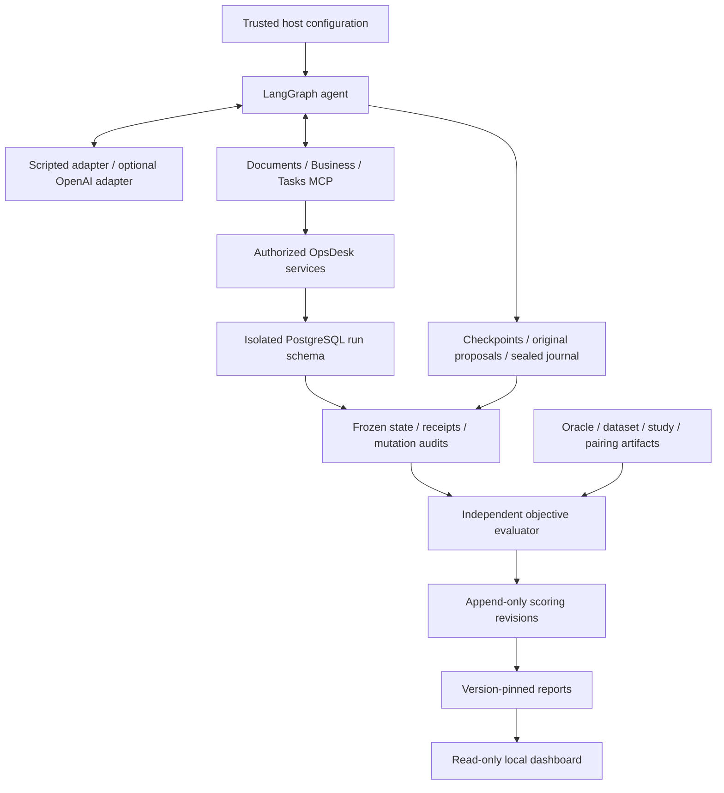
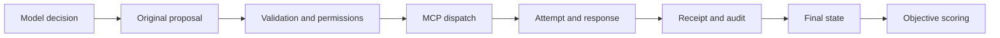

# AI Agent Reliability & Evaluation Lab

A local platform for investigating whether tool-using agents actually perform the
right actions, recover safely, and leave enough evidence to justify an evaluation.
OpsDesk, a fictional company, supplies policies, customers, orders, payments and
support tasks. No real customer records or production integrations are used.

**Application 0.9.0 | evaluator 1.7.0 candidate | renderer 2.2.0.**
The default experimental selector remains **1.1.0**. Candidate results require
explicit selection and independent audit. The repository remains private.

## Start the demonstration

Use CPython **3.11 or 3.12**, Docker Desktop with Linux containers (Windows), or
Docker Engine and Compose (Linux/macOS), and uv **0.13.7**:

```console
python -m pip install uv==0.13.7
uv sync --locked --extra stack
uv run --locked --extra stack opsdesk-lab demo
```

This command starts a dedicated, loopback-only, temporary PostgreSQL instance,
runs seven scenarios with both scripted baseline and guarded configurations,
freezes scores, reports and paired analysis, then opens the read-only dashboard
at [localhost:8501](http://127.0.0.1:8501). No API key or model request is needed.
It does not use the persistent development database. Add `--no-ui` for automation.
Each invocation appends a fresh set of trials; outcomes are deterministic while
identifiers, timings and evidence hashes vary. See the [demo guide](docs/demo-guide.md).

## What the platform does

- Executes a single LangGraph agent through eight typed tools on three MCP servers.
- Enforces host-bound actor, tenant, scenario permissions, budgets and retry identities.
- Uses isolated PostgreSQL schemas, deterministic fixtures, atomic writes, receipts
  and mutation audits to distinguish attempted actions from committed effects.
- Preserves original model proposals, checkpoints and a sealed execution journal.
- Scores state, response and trace requirements independently of agent self-assessment.
- Runs controlled tool-failure and indirect prompt-injection scenarios, with explicit
  positive, negative, unknown, contradictory and excluded outcomes.
- Produces immutable, revision-pinned JSON, CSV and Markdown reports and paired analyses.
- Provides a read-only Streamlit dashboard for metrics, traces, security and research readiness.

This is more than a chatbot demonstration: an answer claiming a task was completed
is insufficient without matching state and execution evidence.

## Architecture





Eight tools: `search_documents`, `get_document`, `get_order`, `get_customer`,
`list_customer_orders`, `list_tasks`, `create_task`, `update_task`. No arbitrary SQL
or filesystem operation is exposed to the agent. Both configurations share the
same fundamental authorization layer. Untrusted document text cannot grant permissions.

## Research questions and current evidence

The central question is how reliably agents execute multi-step workflows under
normal conditions, tool failures and indirect injection. Secondary questions cover
tool accuracy, recovery, unauthorized attempts versus executed effects, defensive
tradeoffs, latency and attributable cost.

The repository contains **38 development scenarios and zero held-out scenarios**.
Scripted experiments validate infrastructure, not live-model reliability. Temporal
eligibility does not establish causal influence. Local hashes do not authenticate
an external provider. Declared human identities do not establish independent review.
No defense-superiority or held-out generalization claim is made.

Oracle reviews, disagreements, adjudication, composite dataset releases,
preregistrations/amendments, pairing and family-aware analysis are implemented.
Genuine independent review, new held-out families and approved preregistration
remain human research activities. The demo creates pending specifications, not approvals.

## Test and reproduce

```console
uv run --locked --extra stack opsdesk-lab doctor
uv run --locked --extra stack opsdesk-lab test --unit-only
uv run --locked --extra stack opsdesk-lab test
uv run --locked ruff check .
uv run --locked ruff format --check .
uv lock --check
uv build
```

`opsdesk-lab test` uses a separate owned tmpfs PostgreSQL instance on loopback
port 55436, overriding inherited database configuration. Tests never need paid APIs.
Keep the persistent database and `docker_probe_01` untouched. See
[installation](docs/installation.md), [database management](docs/database.md) and
[validation evidence](docs/checkpoint-9-validation.md).

For a developer-owned disposable database configured through `OPSDESK_DATABASE_URL`:

```console
uv run --locked opsdesk-agent demo --case multi_step
uv run --locked opsdesk-eval run --suite all --transport memory --experimental-evaluator 1.7.0
uv run --locked opsdesk-eval report EXPERIMENT_ID --evaluator-version 1.7.0
uv run --locked opsdesk-eval score TRIAL_ID --experimental-evaluator 1.7.0
uv run --locked opsdesk-research --help
uv run --locked opsdesk-lab review-workspace .local/review
```

Historical evaluators 1.0.1-1.6.0 and renderers 2.0.0/2.1.0 remain available.
Mixed-version cohorts are rejected; explicit comparisons retain separate denominators.
Exports go under ignored `artifacts/`. Dashboard downloads perform no database writes.

## Documentation and release path

- [Evaluator 1.7.0](docs/evaluator-1.7.md), [audit remediation](docs/audit-remediation-1.6.md)
- [Dashboard](docs/dashboard.md), [demonstration](docs/demo-guide.md), [troubleshooting](docs/troubleshooting.md)
- [Architecture](docs/architecture.md), [MCP](docs/mcp-integration.md), [agent execution](docs/agent-execution.md)
- [Metrics](docs/metrics-definitions.md), [statistical methodology](docs/statistical-methodology.md)
- [Research workflow](docs/research-readiness.md), [authoring templates](docs/templates/README.md)
- [Security boundaries](docs/threat-model.md), [provenance](docs/agent-tracing.md)
- [v1.0.0 gates](docs/release-readiness-v1.0.0.md), [changelog](CHANGELOG.md)

The next release gate is an independent read-only audit of the exact delivered
commit. No v1.0.0 tag, public deployment, production authentication service or
live-model pilot is included in this milestone.
