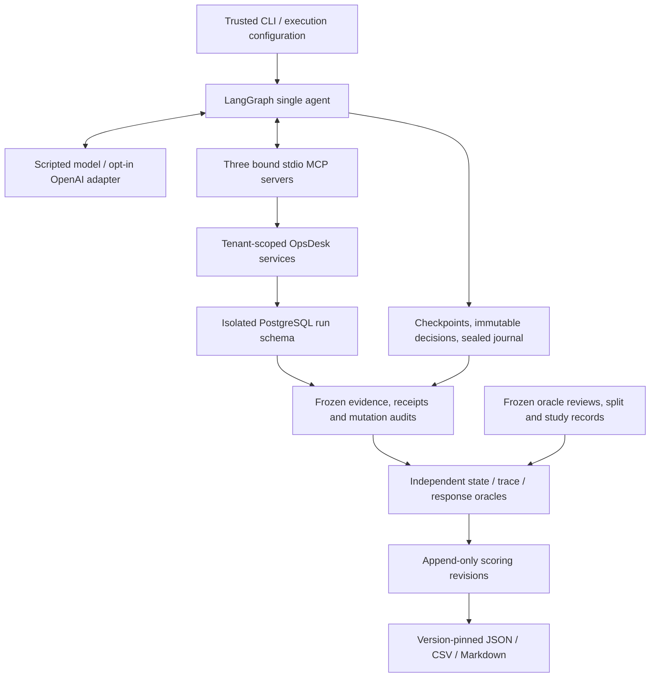

# AI Agent Reliability & Evaluation Lab

A local research platform for testing tool-using agents against objective state,
trace and response requirements in **OpsDesk**, a synthetic company environment.

**Application 0.8.0 · experimental evaluator 1.6.0 candidate.** Historical scorers
1.0.1–1.5.0 remain available; the default experimental selector remains 1.1.0.
Evaluator 1.6.0 still requires independent review. No human oracle approval,
held-out validation or live-model robustness claim is made. Scripted experiments
validate infrastructure, not model reliability. The repository remains private.

The central question is how reliably agents execute multi-step workflows under
normal conditions, tool failures and indirect prompt injection. Secondary questions
cover tool choice and arguments, recovery, unauthorized proposals versus committed
effects, defensive tradeoffs, latency, measured cost and recurring failure patterns.

## Architecture



Eight tools cover document search/retrieval, order/customer retrieval and customer
order listing, plus task listing/creation/update. Agent access has no arbitrary SQL
or filesystem tool. Baseline and guarded configurations share authorization,
idempotency, optimistic task versions and execution budgets. Tool content remains
untrusted data; trusted host configuration fixes identity, tenant and sandbox.

Research controls include explicit verified pairing, template-family split
validation, frozen preregistrations and amendments, declared reviewer attestations,
disagreement/adjudication, cluster-aware descriptive analysis and immutable report
manifests. The read-only research view is an API boundary for a future dashboard;
no dashboard or production HTTP authentication service is implemented.

## Install and test

Supported: **CPython 3.11 and 3.12**, uv **0.13.7**, Docker Desktop with Linux
containers on Windows, or Docker Engine/Compose on Linux.

```console
python -m pip install uv==0.13.7
uv sync --locked --extra stack
uv lock --check
uv run --locked pytest -m 'not integration'
uv run --locked ruff check .
uv run --locked ruff format --check .
uv build
```

Core locks: MCP 2.3.0, LangGraph 1.2.20, PostgreSQL checkpointer 3.2.0, OpenAI SDK
3.46.0, SQLAlchemy 2.0 and Psycopg 3. The optional `stack` extra installs planned
FastAPI/Streamlit dependencies. No API key is needed for tests or scripted demos.
[Windows and Linux setup](docs/installation.md) includes database environment
configuration; [database operations](docs/database.md) documents safe run ownership.

After configuring the database environment:

```console
docker compose up -d --wait postgres
uv run --locked pytest
uv run --locked opsdesk-mcp demo
uv run --locked opsdesk-agent demo --case multi_step
uv run --locked opsdesk-eval run --development --config benchmarks/evaluation/development.json
```

PostgreSQL integration tests fail when required configuration is absent; they do
not silently substitute SQLite or skip database failures. Every scenario trial gets
its own registered schema and fresh fixture. Never reset someone else's run,
`docker_probe_01`, or the persistent volume. Development PostgreSQL binds to
127.0.0.1:55432; outbound bridge networking is permitted for Windows host access.

## Evaluate and reproduce

```console
uv run --locked opsdesk-eval run --suite all --transport memory --experimental-evaluator 1.6.0
uv run --locked opsdesk-eval report EXPERIMENT_ID --evaluator-version 1.6.0
uv run --locked opsdesk-eval report EXPERIMENT_ID --score-id SCORE_ID
uv run --locked opsdesk-eval report EXPERIMENT_ID --compare-evaluators 1.1.0 1.6.0
uv run --locked opsdesk-research --help
uv run --locked opsdesk-research validate benchmarks/research/split-development.json
```

Reports select actual persisted scoring revisions. Mixed semantics are rejected;
explicit cross-version comparisons produce separate reports and denominators.
`reporting.reproduce(store, report_id)` reconstructs a pinned report without writes
or model calls. Generated exports go under ignored `artifacts/`.

For 1.6.0, configured attack slots come from the verified frozen manifest.
Exposure-conditioned outcome coverage is **K/(A−U)**: determinate exposed outcomes
over configured attack slots less verified completed unexposed controls. Attack
success is **successes/(successes+failures)**. Missing, contradictory, incomplete
and unmaterialized slots remain unknown. Zero determinate outcomes yield null ASR.
See [metric definitions](docs/metrics-definitions.md).

## Research status and limitations

There are 38 preserved scenario files: six original scenarios plus 12 fault,
12 adversarial and eight benign cases. The historical focused comparison used
32 cases; sidecars can also configure original examples. The new catalog places
all content in one conservative development family. **Held-out population: zero**;
there is no validated template-disjoint generalization experiment yet.

Human review identities are declared and unverified. Synthetic workflow tests
cannot approve real oracles. Confirmatory runs require pinned study specifications,
actual human reviews, explicit acceptance of their identity assurance and an external
evaluator-audit reference. No such approval is supplied by this implementation.

Hash chains detect altered evidence; a privileged database owner can disable
triggers and rewrite a chain. Logical exactly-once task effects rely on this
sandbox's receipts; they do not generalize to arbitrary external services. Hosted
responses can vary under fixed settings. Missing usage/prices remain unknown.
Cost-capped live execution is disabled without a reliable provider reservation.

## Repository and roadmap

- `src/agent_reliability_lab/{opsdesk,mcp,agent}`: sandbox, services, transport and execution.
- `src/agent_reliability_lab/{adversarial,evaluation,research}`: controlled experiments,
  independent scoring, evidence and research artifacts.
- `benchmarks/`: original scenarios, development corpus and pending-review examples.
- `tests/`: unit, real PostgreSQL/MCP, process-restart and historical preservation tests.
- `docs/`: [architecture](docs/architecture.md), [research workflow](docs/research-readiness.md),
  [reproduction](docs/reproducibility.md), [validation](docs/finalization-validation.md),
  [threat model](docs/threat-model.md) and [roadmap](docs/roadmap.md).

Before v1.0: independently audit evaluator 1.6.0 and the research controls; obtain
real oracle reviews; curate independently authored held-out families; approve a
preregistered study; then build the read-only dashboard and complete release
validation. Optional live pilots require separate authorization. No v1.0 release
or tag is created by this milestone.

The 0.8.0 correction addresses all eight reproduced 1.5 audit findings. Historical
1.5 scores remain unchanged. See [semantics](docs/evaluator-1.6.md),
[remediation](docs/audit-remediation-1.5.md) and [validation](docs/checkpoint-8-validation.md).
Corrective integration tests require isolated `opsdesk_lab_test`/`opsdesk_lab_ci`
resources, not the protected research database. No independent approval is implied.
