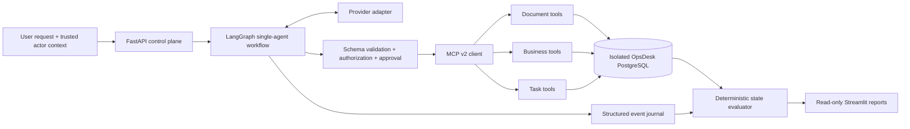

# Architecture

Status after Checkpoint 1: scenario contracts, synthetic PostgreSQL infrastructure,
fixtures, lifecycle management and internal Python services are implemented. The
diagram below describes the eventual system; FastAPI, MCP handlers, model adapters,
graphs, evaluator and dashboard are still planned. See [database.md](database.md)
and [ADR 0002](decisions/0002-postgresql-sandbox.md) for the implemented subsystem.

## Components and data flow

FastAPI will manage run requests, configuration and status, not bypass tool
authorization. MCP servers will expose the eight narrow operations in
[tool-contracts.md](tool-contracts.md). PostgreSQL will contain synthetic domain
records, task mutation audit records, and run metadata in separate schemas. Each
run gets a fresh database namespace and immutable fixture snapshot. Start with
stdlib JSON artifacts for traces; add storage only when required. Streamlit will
read completed experiment artifacts, not hold provider credentials or mutate runs.

Docker/Compose now packages PostgreSQL 18.6 with a release/digest pin, loopback
port and persistent volume. The development bridge uses `internal: false` for
Windows host connectivity and permits container egress; stronger evaluation
isolation requires a separate tested configuration. Python services use SQLAlchemy Core/Psycopg, Alembic
per-schema migrations and registered per-run schemas. MCP servers and tool
containers remain deferred under the revised checkpoint scope. No production
connectors are allowed.

## LangGraph workflow (planned)

`input -> budget check -> model -> tool proposals -> validate/authorize ->
optional approval -> MCP execution -> validate result -> state update -> budget
check -> model ... -> final response -> evaluation`.

Use `StateGraph` with explicit conditional edges; do not hide this loop inside
another agent framework. The state contains run/scenario/config IDs, actor context,
typed message references, outstanding tool-call IDs, observations with provenance,
budget counters, outcomes and termination reason. It does not store private
chain-of-thought. A tool proposal cannot alter trusted identity, policy or budgets.
Check limits before and after every call; timeouts and cancellation count toward
wall time. Serialize mutations initially. Exhaustion yields a terminal result with
an explicit reason and preserved trace, never another automatic retry.

Provider adapters normalize request messages, tool schemas, tool proposals, final
responses, finish reasons, provider request IDs and nullable token usage. Preserve
raw provider response metadata separately for audit. Do not assume identical tool
semantics or tokenizer behavior across providers. Implement one adapter first;
add a second before comparing providers. Provider SDKs are deferred dependencies.

## Baseline and guarded variants

Both variants share graph, model, prompt task, tools, actor, essential schema
checks, deny-by-default server authorization, transport limits, write idempotency,
approval gates and total execution budgets. Baseline returns tool errors to the
model with no application retry or repair loop; the model may try again within
its ordinary budget. It never gets destructive unrestricted access.

Guarded adds classified transient retry (at most two extra attempts per logical
call), bounded argument repair (one extra model call per invalid proposal), output
schema validation with fail-closed handling, explicit untrusted-data framing and
injection alerts. Retry writes only with a stable idempotency key; ambiguous
outcomes require reconciliation before retry. Every physical attempt consumes
budget and cost. Fix policies before evaluation and use ablations to attribute
effects; guards may reduce both attack success and legitimate task success.

## Execution journal contract (planned)

Append events with schema version, run ID, sequence number, parent/logical-call ID,
UTC timestamp, monotonic elapsed time, event kind, actor, config hash, tool name,
validated/redacted arguments, authorization and approval decisions, dispatch flag,
execution outcome, audit transaction ID, error class, injection ID and token/cost
records. Log proposals **before** authorization, including unknown tools and invalid
arguments. Record dispatch separately from committed effects; reconcile tool and
database audit records after timeouts. A denied request has `executed=false`.
Sensitive data is synthetic, but still minimize raw payload retention.

## Stack and support

Supported Python: CPython 3.11 and 3.12; primary development version 3.11. Python
3.13+ is deliberately outside this checkpoint's support range. Minimal installation
requires Pydantic 2, SQLAlchemy 2.0 Core, Alembic and Psycopg 3; optional `stack`
dependencies lock FastAPI, LangGraph 1, official MCP SDK 2 and Streamlit. This
verifies future stack compatibility without claiming those runtimes exist. Core
provides safe queries without an ORM model/session layer. No vector database,
multi-agent coordinator or extra orchestration framework is introduced.

Dependency decisions were reviewed on 2026-11-08 against official sources:

- [LangGraph Graph API quickstart](https://docs.langchain.com/oss/python/langgraph/quickstart)
  supports explicit graph nodes and tools; only `langgraph` is added directly.
- [MCP installation](https://py.sdk.modelcontextprotocol.io/get-started/installation/)
  identifies v2 as stable. Use `MCPServer` and `Client` when implemented; consult
  the [v2 migration guide](https://py.sdk.modelcontextprotocol.io/migration/),
  not v1 `FastMCP` examples or mandatory legacy session handshakes.
- [Pydantic models](https://docs.pydantic.dev/latest/concepts/models/),
  [FastAPI versioning](https://fastapi.tiangolo.com/deployment/versions/),
  [Psycopg installation](https://www.psycopg.org/psycopg3/docs/basic/install.html),
  [Streamlit installation](https://docs.streamlit.io/get-started/installation), and
  [uv lock/sync](https://docs.astral.sh/uv/concepts/projects/sync/).

`uv.lock` records exact resolved artifacts and hashes; bounded declarations in
`pyproject.toml` communicate supported major lines. CI uses uv 0.13.7 and
`uv sync --locked --extra stack` so stale locks fail instead of silently changing.
