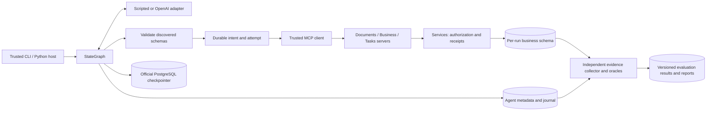

# Architecture

Application 0.9.0 retains one custom LangGraph `StateGraph`, optional OpenAI
and scripted providers, PostgreSQL checkpoints, execution journals and independent
scoring. It adds trusted fault interception, lower-trust response overlays,
verified exposure, baseline/guarded scopes and paired trials. Existing database
services/eight MCP tools remain the business boundary. FastAPI, multi-provider
live research comparisons remain optional future work. A local read-only Streamlit
dashboard, immutable paired analysis and scripted product demonstration are implemented.

## Explicit graph

`START -> prepare -> decide -> validate -> dispatch -> record -> decide ... ->
finalize -> END`. Conditional edges terminate on limits/errors. A decision may
propose several tools; dispatch is serial and each observation is recorded before
the next model turn. Retryable tool failures take the bounded dispatch edge.
There is no hidden agent loop, automatic LangGraph retry policy or second agent.

Typed JSON-only state carries messages, normalized decisions, proposal references,
cursor/turn, error flags and final response status. Identity/configuration stays
in the trusted execution host, outside tool arguments. Active graph nodes consume
durable graph-step budget; model requests and MCP attempts have separate counters.

Discovery uses the three existing SDK clients. Provider schemas deep-copy MCP
schemas with explicit OpenAI non-strict function mode to preserve optional/default
semantics. Local JSON Schema validation precedes dispatch; MCP servers still
validate inputs, outputs and authorization. The model catalog intersects scenario
availability with the host allowlist. Role/tenant/resource/scenario permissions
remain server-enforced. No direct business-service path exists in the agent.

## Persistence boundaries

Business schemas remain `opsdesk_run_*`, registered in `opsdesk_control`.
`opsdesk_agent` holds independently migrated executions, events, model requests,
operation intents and attempts. `opsdesk_agent_checkpoints` holds official saver
tables. JSON serialization excludes pickle and arbitrary Python reconstruction.
Graph calls use synchronous checkpoint durability.

Official `PostgresSaver` blocking methods run in worker threads through a thin
async adapter. This preserves Windows' Proactor loop for MCP stdio subprocesses
while avoiding Psycopg async's incompatible loop requirement. The saver's own
connection lock serializes checkpoint operations. Python 3.11 and 3.12 are
supported; local validation uses 3.11, CI includes both.

A session advisory lock claims each execution. A shared sandbox lifecycle lease
blocks reset/cleanup during execution. Resume validates the complete host config
hash and pinned marker/seed. Reset now atomically rotates the existing ownership
marker after logical fixture verification: equivalent business data is restored,
but paused executions cannot reuse identities after receipts are cleared.

Intent arguments and host logical write ID commit before MCP dispatch. Distinct
attempt IDs consume budgets. Resume of an unknown write reuses that intent and
MCP receipt key. Responses commit before graph observations; completed replies
and operations are cached across node replay. Terminal metadata/event commit
together. See [execution](agent-execution.md), [tracing](agent-tracing.md) and
[ADR 0004](decisions/0004-durable-agent.md).

## Models, budgets and security

Official OpenAI async Chat Completions uses an explicit model ID, output token
limit, disabled SDK retries and `store=False`. Only `--live` permits requests.
There is no fallback or hardcoded pricing. Provider identity/request IDs and
nullable usage are captured. Scripted tests use the same execution path, indexed
by durable model turn. Hidden reasoning is neither requested nor stored.

UTC wall deadlines survive downtime; active latency uses `perf_counter`. Unknown
crash intervals mark timing incomplete. Limits are checked before operations.
Timeout cancellation cannot prove an executing remote write rolled back; receipt
reconciliation is required. Documents/results remain untrusted message data.
Redaction and bounds apply before graph/journal persistence.

Baseline and guarded variants share these authorization boundaries and the same
minimal bounded recovery policy. Checkpoint 5 adds explicit host write scopes,
observation framing and paired defensive controls. No production authentication, HTTP endpoint, universal
exactly-once guarantee is implemented. Objective predicates live in the separate
evaluation package; model-declared completion remains unchanged in agent results.

## Infrastructure and reviewed APIs

Compose retains PostgreSQL 18.6 pinned by digest, persistent storage, loopback
`127.0.0.1:55432`, health checks and `internal: false` for Windows host connectivity.
The container permits outbound networking; stronger evaluation isolation needs
separate validation. SQLAlchemy Core/Psycopg and Alembic remain the database stack.
No production connectors are supported.

Pinned core libraries: LangGraph 1.2.20, checkpoint-postgres 3.2.0, official MCP
2.3.0 and OpenAI 3.46.0. `uv.lock` fixes artifacts/hashes. FastAPI/Streamlit remain
optional planned runtimes. Official sources reviewed:

- [LangGraph Graph API](https://docs.langchain.com/oss/python/langgraph/graph-api),
  [persistence](https://docs.langchain.com/oss/python/langgraph/persistence),
  [fault tolerance](https://docs.langchain.com/oss/python/langgraph/fault-tolerance),
  [checkpointers](https://docs.langchain.com/oss/python/langgraph/checkpointers).
- [OpenAI function calling](https://developers.openai.com/api/docs/guides/function-calling),
  [official Python Chat Completions API](https://developers.openai.com/api/reference/python/resources/chat/subresources/completions/methods/create).
- [MCP v2 documentation](https://py.sdk.modelcontextprotocol.io/).

## Independent evaluator

The runner provisions a new registered sandbox per trial and sends only the
scenario user request to the existing agent. Hidden oracles/annotations remain
in `opsdesk_evaluation`, outside MCP and model input. Consistent initial/full final
snapshots, compact ledger projections, receipts and audits form immutable evidence.
Receipt-backed logical effects are distinct from physical attempts. New scoring
revisions store complete oracle specs and evaluator source/version, without
re-executing. Reports select one revision per trial and expose exclusions/coverage.
See [evaluation engine](evaluation-engine.md), [metrics](metrics-definitions.md)
and [ADR 0005](decisions/0005-objective-evaluation.md).

All historical revisions remain frozen. A new evaluation migration is additive.
Shared migration locking protects Alembic's global context, and cleanup optionally
pins an expected marker atomically. Existing callers/tools retain their contracts.
Opt-in Checkpoint 5 sidecars execute controlled faults/attacks; unconfigured
legacy specifications remain explicitly excluded. Verified exposure, not mere
configuration, determines recovery/attack metric eligibility.

## 0.7.0 research finalization

The execution/service architecture above remains intact. New execution provenance
seals immutable requests, decisions, original proposals, responses and journal events;
normalized operations remain separate. Additive agent/evaluation migrations install
write-once and frozen-record guards without changing historical rows. Evaluator 1.5.0
uses a common provenance gate across every attacker predicate. Versions 1.0.1–1.4.0
remain available and default experimental selection remains 1.1.0.

Reports pin actual selected scoring revisions in immutable manifests, reject mixed
semantic/implementation cohorts and derive planned populations from verified manifests.
The new `research` package stores typed, append-only oracle/reviewer/review/adjudication,
pair/split/study/amendment records. Its CLI is trusted administration; `ResearchView`
is a bounded, read-only query surface for a later UI. No dashboard is implemented.
See [ADR 0007](decisions/0007-research-finalization.md) and
[research workflow](research-readiness.md). Independent approval is pending.

## 0.8.0 correction boundaries

New 1.6 attribution/projection/population modules leave frozen 1.5 helpers intact.
Canonical outcome resolution connects scoring and reporting. Composite dataset-release
artifacts reuse append-only research storage; no persistence redesign or migration
is required. Pair analysis checks oracle/revision identities and distinct underlying
trial/execution units before statistics. See [audit remediation](audit-remediation-1.5.md).

## Checkpoint 9 extension (0.9.0)

Candidate 1.7 uses projection v3, logical/physical lifecycle joins and canonical outcome policy v2. Renderer 2.2.0, immutable exact-score AnalysisRecord artifacts and a seven-page Streamlit dashboard extend the existing architecture; no new agent architecture or business service is introduced. Dashboard ResearchView connections enforce read-only PostgreSQL transactions. Demo/test launchers use separate labeled tmpfs instances, not the persistent research database.

### Product boundaries

The 1.0.0 launchers use packaged Compose files, explicit project names and
ownership, mount and loopback checks before starting or stopping a disposable
PostgreSQL service. A workspace argument selects scenario or test inputs. It cannot
redirect Docker operations. The dashboard exposes frozen report content through a
read-only research view, with experiment purpose and trial split visible.

The `platform` CLI is the trusted operator: it can start only named, ownership-checked
standalone demo/test instances. The `dashboard` is a reader: it cannot provision,
execute agents, alter artifacts or register reviews. `evaluation.downloads` is a pure
serializer. `AnalysisRecord` adds a kind to the existing immutable generic artifact
store, so no database migration is required. Wheel resources include only committed
synthetic specifications and standalone Compose definitions, never local reports.

## Reliability evidence

The optional notifications MCP domain is restricted to a registered scripted
reliability sandbox in a disposable database. The synthetic provider runs in a
separate transaction. See [external effects](external-effects.md) and
[context drift](context-drift.md). Historical evaluator and renderer versions
retain their existing scoring and report semantics.
