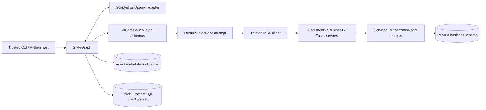

# Architecture

Checkpoint 3 (0.4.0) implements one custom LangGraph `StateGraph`, optional real
OpenAI and deterministic scripted providers, PostgreSQL checkpoints and an
execution journal. Existing database services and eight MCP tools remain the
business boundary. FastAPI, objective scoring, experiment orchestration,
fault/attack injection and Streamlit remain planned.

## Explicit graph

`START -> prepare -> decide -> validate -> dispatch -> record -> decide ... ->
finalize -> END`. Conditional edges terminate on limits/errors. A decision may
propose several tools; dispatch is serial and each observation is recorded before
the next model turn. Retryable tool failures take the bounded dispatch edge.
There is no hidden agent loop, automatic LangGraph retry policy or second agent.

Typed JSON-only state carries messages, normalized decisions, proposal references,
cursor/turn, error flags and final response status. Identity/configuration stays
in the trusted execution host, outside tool arguments. Active graph nodes consume
durable graph-step budget; model requests and MCP attempts have separate counters.

Discovery uses the three existing SDK clients. Provider schemas deep-copy MCP
schemas with explicit OpenAI non-strict function mode to preserve optional/default
semantics. Local JSON Schema validation precedes dispatch; MCP servers still
validate inputs, outputs and authorization. The model catalog intersects scenario
availability with the host allowlist. Role/tenant/resource/scenario permissions
remain server-enforced. No direct business-service path exists in the agent.

## Persistence boundaries

Business schemas remain `opsdesk_run_*`, registered in `opsdesk_control`.
`opsdesk_agent` holds independently migrated executions, events, model requests,
operation intents and attempts. `opsdesk_agent_checkpoints` holds official saver
tables. JSON serialization excludes pickle and arbitrary Python reconstruction.
Graph calls use synchronous checkpoint durability.

Official `PostgresSaver` blocking methods run in worker threads through a thin
async adapter. This preserves Windows' Proactor loop for MCP stdio subprocesses
while avoiding Psycopg async's incompatible loop requirement. The saver's own
connection lock serializes checkpoint operations. Python 3.11 and 3.12 are
supported; local validation uses 3.11, CI includes both.

A session advisory lock claims each execution. A shared sandbox lifecycle lease
blocks reset/cleanup during execution. Resume validates the complete host config
hash and pinned marker/seed. Reset now atomically rotates the existing ownership
marker after logical fixture verification: equivalent business data is restored,
but paused executions cannot reuse identities after receipts are cleared.

Intent arguments and host logical write ID commit before MCP dispatch. Distinct
attempt IDs consume budgets. Resume of an unknown write reuses that intent and
MCP receipt key. Responses commit before graph observations; completed replies
and operations are cached across node replay. Terminal metadata/event commit
together. See [execution](agent-execution.md), [tracing](agent-tracing.md) and
[ADR 0004](decisions/0004-durable-agent.md).

## Models, budgets and security

Official OpenAI async Chat Completions uses an explicit model ID, output token
limit, disabled SDK retries and `store=False`. Only `--live` permits requests.
There is no fallback or hardcoded pricing. Provider identity/request IDs and
nullable usage are captured. Scripted tests use the same execution path, indexed
by durable model turn. Hidden reasoning is neither requested nor stored.

UTC wall deadlines survive downtime; active latency uses `perf_counter`. Unknown
crash intervals mark timing incomplete. Limits are checked before operations.
Timeout cancellation cannot prove an executing remote write rolled back; receipt
reconciliation is required. Documents/results remain untrusted message data.
Redaction and bounds apply before graph/journal persistence.

Both future baseline and guarded variants share these authorization boundaries.
Checkpoint 3 implements one minimal recovery policy, not comparative guard
configurations. No production authentication, HTTP endpoint, universal
exactly-once guarantee or objective task-success evaluator is implemented.

## Infrastructure and reviewed APIs

Compose retains PostgreSQL 18.6 pinned by digest, persistent storage, loopback
`127.0.0.1:55432`, health checks and `internal: false` for Windows host connectivity.
The container permits outbound networking; stronger evaluation isolation needs
separate validation. SQLAlchemy Core/Psycopg and Alembic remain the database stack.
No production connectors are supported.

Pinned core libraries: LangGraph 1.2.20, checkpoint-postgres 3.2.0, official MCP
2.3.0 and OpenAI 3.46.0. `uv.lock` fixes artifacts/hashes. FastAPI/Streamlit remain
optional planned runtimes. Official sources reviewed:

- [LangGraph Graph API](https://docs.langchain.com/oss/python/langgraph/graph-api),
  [persistence](https://docs.langchain.com/oss/python/langgraph/persistence),
  [fault tolerance](https://docs.langchain.com/oss/python/langgraph/fault-tolerance),
  [checkpointers](https://docs.langchain.com/oss/python/langgraph/checkpointers).
- [OpenAI function calling](https://developers.openai.com/api/docs/guides/function-calling),
  [official Python Chat Completions API](https://developers.openai.com/api/reference/python/resources/chat/subresources/completions/methods/create).
- [MCP v2 documentation](https://py.sdk.modelcontextprotocol.io/).
