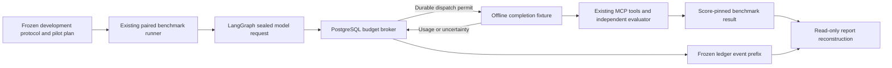

# Checkpoint 15 · Development feasibility pilot

CP15 exercises provider-call accounting around the existing LangGraph and MCP agent with synthetic OpsDesk data. It uses the CP12 registered development protocol, counterbalanced paired schedule, independent evaluator, immutable score revisions, and evidence verifier. CP13 sealed catalogs and CP14 confirmatory allocations are outside this execution path. The provider simulation runs in process, through the OpenAI chat request shape and completion parser, without a network transport or credential lookup.

## Architecture



The pilot plan pins the exact CP12 protocol and schedule hash, exact requested provider and model configuration, model allowlist, versioned USD pricing manifest, ledger ID, and all capacity limits. Amendments must link the previous plan and use a new ledger. Each supported pilot opens a ledger once. The brokered adapter joins the sealed model request to its actual execution, registered trial, sandbox, actor, tenant, schedule slot, and arm before admission. A direct adapter call without a sealed request is rejected. The evaluation runner also rejects the legacy live flag and arbitrary model factories when given benchmark context.

## Reservation and recovery

| State | Meaning | Capacity treatment |
| --- | --- | --- |
| `reserved` | The proposal passed allocation, configuration, deadline and capacity checks | Holds one call and the upper token and USD amount |
| `cancelled` | A worker explicitly cancelled a reservation that never received a dispatch permit | Capacity becomes available |
| `dispatched` | The only dispatch permit was committed, and invocation may have started | Keeps the full hold |
| `uncertain` | Invocation timed out, failed without a usable response, or was cancelled | Keeps the full hold |
| `observed` | A reply or failure was recorded with incomplete usage or model identity | Keeps the full hold |
| `settled` | Complete expected-model counts support cost reconciliation | Consumes one call and reconciled tokens and cost |
| `breached` | The returned model or an observed quantity exceeded the frozen contract | Keeps at least the original hold and blocks further admissions and dispatches |

The additive `opsdesk_pilot` schema is initialized only on explicitly test-owned `opsdesk_lab_ci` or `opsdesk_lab_test` databases. A row lock serializes operations within a ledger. A database-wide physical-attempt key prevents reuse across ledgers. Identical replays are idempotent, conflicting replays fail, and dispatch state commits before the adapter invokes the fixture. The broker uses PostgreSQL time to admit reservations and dispatches and bounds the fixture await by the remaining experiment window. A deadline stops further dispatches. Existing dispatches retain their holds and may reconcile after the deadline.

After a restart, a pending reservation can be cancelled with its exact identity. A committed dispatch with an unknown outcome retains its hold, even if the process stopped between recording the dispatch and sending it. Late evidence may complete missing fields in a consistent observation, and duplicate settlement is idempotent. A provider retry requires a fresh physical identity, a valid predecessor for the same execution and turn, and remaining per-turn and experiment retry limits. It reserves another call and full capacity. The pilot adapter has no automatic provider retries. MCP retry semantics are unchanged.

## Cost and evidence

The broker reuses the versioned `PriceBook` contract. A price must match the exact requested model and cover the experiment window. Admission reserves the frozen input ceiling and effective output limit at the most expensive applicable input rate, plus the output cost and any fixed request fee. Local input-size estimates are recorded separately. The draft utility supplies visibly synthetic pricing. No API price is embedded or inferred from a model alias.

Settlement records input and output token observations, reported model and provider request ID, and a billed USD value when available. The conservative charge uses the greater of the rate-based estimate and any observed bill. Missing usage remains unmeasured. A failed response can have nonzero usage. A returned model mismatch freezes the ledger because the original pricing may no longer apply. Neither local estimates nor provider usage counts establish an external invoice.

The report pins the registered pilot, benchmark result, score revisions, trial evidence, and an exact prefix of append-only broker events. Verification reconstructs the programmatic benchmark result and checks budget attempt references against the sealed model journal and response observations where trial evidence is available. JSON, CSV and Markdown exports reproduce the same frozen observation. Later settlement does not change earlier export bytes. Provider evidence and objective task scores remain separate. Uncertainty, exclusions, and applicability come from the established development benchmark contracts. The CP15 report digest is verified against its pinned inputs under the research database trust model. Existing Ed25519-authenticated reliability reports and their trust model remain in use for those publications.

## Safe reproduction

Use a fresh Compose project whose test PostgreSQL port is free. Inspect the container identity and verify that its data directory uses tmpfs with no persistent volume. The commands below use a POSIX shell. On Windows, set the three environment variables with `$env:NAME = 'value'` and use a fresh directory under `$env:TEMP` for the report files.

```sh
docker compose -p opsdesk-cp15-local -f compose.test.yaml up -d --wait
export OPSDESK_DATABASE_URL=postgresql+psycopg://opsdesk_ci@127.0.0.1:55436/opsdesk_lab_ci
export OPSDESK_ALLOW_SANDBOX=1
export OPSDESK_TEST_OWNED=1
work=$(mktemp -d)
uv run --locked opsdesk-research --scope cp15 init
uv run --locked opsdesk-research benchmark-draft "$work/draft" --repetitions 2
uv run --locked opsdesk-research --scope cp15 append "$work/draft/dataset.json"
uv run --locked opsdesk-research --scope cp15 append "$work/draft/protocol.json" > "$work/protocol-ref.json"
uv run --locked opsdesk-research --scope cp15 benchmark-pilot-draft "$work/protocol-ref.json" --identity cp15_offline > "$work/pilot-plan.json"
uv run --locked opsdesk-research --scope cp15 append "$work/pilot-plan.json" > "$work/pilot-ref.json"
uv run --locked opsdesk-research --scope cp15 benchmark-pilot-run "$work/pilot-ref.json" > "$work/report-ref.json"
uv run --locked opsdesk-research --scope cp15 benchmark-pilot-verify "$work/report-ref.json" --output "$work/report"
docker compose -p opsdesk-cp15-local -f compose.test.yaml down
```

Use `--fixture-fault first_dispatch_timeout` or `--fixture-fault first_usage_missing` when drafting a new pilot to exercise uncertain accounting. The fault applies equally to both arms of the first slot. `benchmark-pilot-verify` uses a PostgreSQL read-only connection. The integration tests exercise real PostgreSQL with offline completions.

## Requirements before separately authorized live execution

- Register a new development-only protocol and a separately authorized `future_live_requested` pilot plan with exact provider, model and configuration, independently sourced pricing, budget, duration and ledger identity.
- Establish an enforceable provider-side spending limit and a reliable maximum billable input and output quantity for the chosen endpoint and configuration, including failure and retry billing. Record applicable fixed fees, metering conventions and returned model identity. The byte-size observation used by the fixture cannot establish this bound.
- Verify the real transport follows the same durable dispatch boundary, has SDK retries disabled, reads environment credentials only after authorization, redacts provider metadata, and can reconcile late or ambiguous usage.
- Keep the development and held-out populations separate. This pilot validates engineering behavior with synthetic responses and provides no estimate of real-model effectiveness.

`future_live_requested` records requested settings for review. CP15 refuses execution in that mode. No combination of CLI flags or environment credentials enables a real CP15 provider request.
