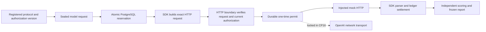

# Checkpoint 16 · Real-model activation readiness

The development pilot uses the existing LangGraph agent, signed MCP operations, versioned objective evaluator, score-pinned pairing, and CP15 PostgreSQL broker. The smallest counterbalanced design uses one existing development scenario, two pairs and four separate seeded sandboxes. The baseline and guarded arms share the same model configuration and budgets. The guarded intervention changes observation framing and task scope. The design measures feasibility and cannot establish held-out performance or isolate the intervention's individual mechanisms. Human protocol review was not performed.

## Transport and authorization



`benchmark_live_authorization` version `development-http-1.0.0` binds the study reference, pilot and allocation hash, research scope, ledger, exact model, pricing hash, provider profile, call and retry limits, token and USD exposure, start window and deadline. The trust boundary is the authorized local operator and research-artifact writer. An artifact author is a declared identity. The broker rechecks the latest authorization under the research publisher's advisory lock when reserving and when issuing the permit. Revocation is an append-only amendment on the same ledger stream. A committed revocation prevents subsequent permits. A permit already committed represents potentially dispatched work, including after a process crash.

The HTTP transport verifies the request method, exact URL and canonical body hash before obtaining its single-use permit. The request pins one non-streaming text completion, the standard tier, `store=false`, an output-token cap, and function tools with parallel calls disabled. SDK retries, transport retries, redirects and environmental proxies are disabled. A fresh billable retry would require a distinct physical request and an eligible parent attempt. The pilot defaults to zero provider retries. The mock covers the real SDK serializer, HTTP request boundary, response parsing, and safe error classification.

The public transport has a separate build-level activation lock. Test authorization accepts only an explicitly injected `httpx2.MockTransport`. No credential, repository artifact or CLI flag turns off the CP16 lock. The future paid entry point additionally requires an explicit `--activate-paid` action and a matching unexpired `paid_openai` authorization. In that mode the environment credential would be read only after activation checks. The fixture ignores it.

## Provider compatibility and pricing

| Surface | CP16 decision |
| --- | --- |
| `POST https://api.openai.com/v1/chat/completions` with text and client-executed function tools | SDK route implemented and exercised with mocked HTTP. Paid transport locked. |
| Exact dated model snapshot | Requires independently reviewed function-tool, standard-tier and token-limit compatibility. Returned model must match the requested snapshot. |
| `latest` or another moving model alias | Incompatible with the fixed-model comparison. |
| Hosted tools, audio, other modalities, unbounded charges or unpriced cache writes | Incompatible with the hard local admission contract. Unexpected metering freezes the ledger. |
| Provider project or organization spend limit | Additional safeguard that requires independent deployment review. OpenAI documents a delay in enforcement. |

Chat Completions limits generated tokens through `max_completion_tokens`, including reasoning and other non-visible tokens. The endpoint does not provide a request parameter for an independently enforced prompt-token cap. For future activation, the exact model and complete request shape need an independently verified upper bound for billable input, including instructions, tool schemas and provider overhead. The byte estimate recorded locally does not establish that bound. [Chat Completions reference](https://developers.openai.com/api/reference/resources/chat/subresources/completions/methods/create), [Token counting](https://developers.openai.com/api/docs/guides/token-counting)

The supplied USD `PriceBook` must identify the exact model, effective window, input, cached-input and output rates, and applicable fixed request fee. The separate profile specifies pricing-review status, the exposure-control basis and an evidence reference. The broker reserves the maximum applicable input rate, capped output, and fixed fee before dispatch. Provider usage supports an estimated settlement. An observed billed amount is a separate field, and an independently obtained invoice remains a separate source. No current API price ships with CP16. Pricing may vary by model, tier, cache behavior and endpoint. [OpenAI pricing](https://developers.openai.com/api/docs/pricing), [OpenAI project spend limits](https://help.openai.com/en/articles/9186755-managing-your-work-in-platform-with-projects)

## Failure semantics and evidence

- Before the permit, a verified non-dispatch can cancel the reservation. After the permit, a connection loss, timeout or crash retains the full hold until reconciliation.
- HTTP errors are classified without retaining response error text, credentials or headers outside the allowlisted request ID. A failed completion with valid usage can still settle. Absent or malformed usage remains unresolved. A model or billed bound breach freezes new admissions and dispatches.
- Revocation and expiry stop future dispatches. Late evidence can settle an earlier physical attempt after restart. Evidence joins the exact wire digest, sealed model-input digest, scope, trial, arm, physical request, provider request ID, returned model, usage and ledger events.
- Reports bind the exact authorization and score revision and pin an event prefix. They verify local database-backed integrity. The SDK response provides neither an independent invoice nor a signature of the experiment. Objective task outcomes derive from the established evaluator and MCP evidence.

## Safe reproduction

Use a fresh disposable Compose project and a free test port. On Windows, set each environment variable with `$env:NAME = 'value'`. The HTTP tests replace both Python HTTP transports' default network handlers and inject a deterministic mock. No API key is required.

```sh
docker compose -p opsdesk-cp16-local -f compose.test.yaml up -d --wait
export OPSDESK_DATABASE_URL=postgresql+psycopg://opsdesk_ci@127.0.0.1:55436/opsdesk_lab_ci
export OPSDESK_ALLOW_SANDBOX=1
export OPSDESK_TEST_OWNED=1
uv run --locked pytest -q tests/integration/test_cp16_http.py
docker compose -p opsdesk-cp16-local -f compose.test.yaml down
```

To prepare an editable draft on an initialized disposable database, substitute a frozen CP12 development protocol reference and externally supplied JSON profile and `PriceBook`. Select the model in the profile. Set the USD exposure with `--maximum-usd`. To obtain a reference file, redirect the JSON output of each `append` command.

```sh
uv run --locked opsdesk-research --scope cp16 benchmark-live-draft cp12-protocol-ref.json cp16-draft --profile provider-profile.json --pricing prices.json --maximum-usd 2.00
uv run --locked opsdesk-research --scope cp16 append cp16-draft/protocol.json
uv run --locked opsdesk-research --scope cp16 append cp16-draft/plan.json > cp16-plan-ref.json
uv run --locked opsdesk-research --scope cp16 benchmark-live-preflight cp16-plan-ref.json
uv run --locked opsdesk-research --scope cp16 benchmark-live-preflight cp16-plan-ref.json --authorization cp16-authorization-ref.json
```

Draft authorization with `benchmark-live-authorize-draft` using the plan reference, the profile file, `--mode mock_http` or `--mode paid_openai`, and an explicit timezone-aware `--deadline`. Register that artifact with `append`. Preflight uses a read-only PostgreSQL transaction and reports `blocked`, `awaiting_operator_authorization`, or `ready_for_mock_validation` on this build. The future `live_ready` status is conditional on the separate activation gate. Preflight never dispatches.

## Before any paid run

- Separately review the deployed public egress gate, provider credential scope and the dedicated provider project's tracked-spend enforcement. Account for propagation delay and in-flight billing. A documented project threshold alone cannot establish a precise per-run invoice ceiling.
- Verify the exact dated model and endpoint support, billable input and output ceilings, all fees, effective pricing window and allowed service tier. Freeze reviewed artifacts and approve the actual experiment and spend separately.
- Define how ambiguous billed usage is reconciled with provider-side records. Confirm the cost of a provider request that fails or loses its response. Use the existing conservative hold until evidence is available.
- Keep held-out execution separate and disabled. The verified results at this checkpoint are offline engineering evidence.
