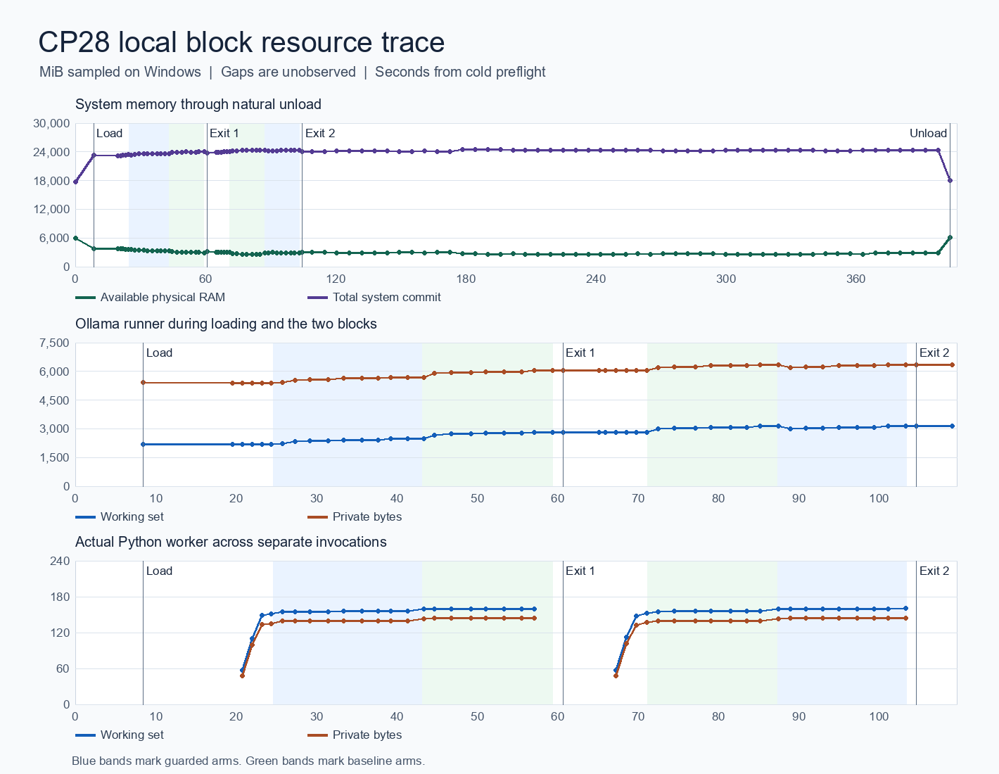

# Checkpoint 28 — Multi-block stability and process attribution

On November 24, 2026, two independent Windows workers completed four genuine
Qwen3.5 4B trials from one frozen allocation. The read-only audit of block 1
passed before block 2 started. All four trials passed the original state and
tool oracle. This engineering qualification covers two short blocks on one
development template on this host.

## Release gate and frozen protocol

CP27 [PR #20](https://github.com/stupidtallguy/agent-reliability-lab/pull/20)
merged into main at `d74448607c144a8e61a03164b1f09c1f7ac560f8`, with reviewed
tree `46c919d98a15898818be594bcd63c3dddb433746`. The
[post-merge workflow](https://github.com/stupidtallguy/agent-reliability-lab/actions/runs/45258516056)
passed on Python 3.11 and 3.12 before inference. The original release tag
object is `0a00726f11e9b3ebc5904bdbfe1f046d3627d730`, peeled to
`f2fbfa75e8bb990671fa692998c5585c2cd5ebe4`. All 13 archived CP27 files
matched their recorded checksums. Retained CP20–CP25 exports matched their
published hashes. CP26 was mock-only. Both cloud activation fuses are false.

`local-ollama-multiblock-1` freezes two pairs, one per process. Seed 42
selected guarded then baseline for block 1 and baseline then guarded for
block 2. Each arm used a fresh disposable sandbox initialized from fixture
seed 251. The scenario was CP26's `cp26_cancelled_order@2`, with the same
user request, three tools, task-scoped guard factors and evaluator 1.7.0
oracle as CP27. The model was `qwen3.5:4b` Q4_K_M under Ollama 0.40.16
at verified IPv4 loopback. Requests used a 4,096-token context, output
limit 256, temperature 0, seed 42 and disabled thinking.

The plan allowed seven physical model calls and eight tool calls per arm,
28 physical model calls total, 120 wall seconds per arm and zero automatic
retries. The ten-minute absolute deadline was sealed before opening the
ledger. The broker uses PostgreSQL's clock and checks the same deadline on
every open and dispatch. Each claim requires 2 GiB available RAM and is
written before starting an arm. The in-trial floor remains 512 MiB.
An unmatched claim or recorded memory stop bars later dispatch under the
same plan. Read-only reconstruction reports unfinished slots separately.

| Frozen identifier | Value |
| --- | --- |
| Run code commit | `b4b073efe19299370035e9c7500688b70f0d1fc3` |
| Canonical Python source SHA-256 | `c760fd89f2080e3b3a586a6a1b0644a5506536839b36f2d9df6469169f75b032` |
| Lockfile SHA-256 | `c3268f7ef73c2536733be17b3f9340c27542e62ef0b5a40bfe108dfab5a2ff4f` |
| Model digest | `d8b0f5e9760cd1682034f292d7ef72ec46f432149be0df7574bf2d6e92e38c04` |
| Dataset SHA-256 | `80a4a8f826e95caca48f8d2e1f990014ded8e7941fea6cd49ad52a9f7cb1cca6` |
| Scenario SHA-256 | `8e05ac32f5792c13bdf8c6c5b97f31ec627cda7ca8d1fd4608f20a97f17c98cd` |
| Oracle SHA-256 | `8758dc9ee607c0b2d8362735ad53b8e429eb0f68ddb28480bbcdb1c154ac505f` |
| Shared tool schema SHA-256 | `2df2f3fb85aaad126e5835ce120e11649c9b8d26c0259d17a70cd2fed3d18d1f` |
| Schedule SHA-256 | `dfa0bad26bd4e5b7288dad64701a7abc970e996674e1cea98bd794292fe16c31` |
| Protocol SHA-256 | `e36a20dc459fb38f65f500b7854d31567a2293eedd53653f39c81af76bdd1a3d` |
| Plan SHA-256 | `09596b9ff548d176824f83583ab259d9f7b37475ae6d114e9d767dae01b5bb54` |
| Run | `run_c9fc5f149e76e0b9ee3369aaea0760a8` |
| Ledger | `e2a5f790791e48dda1f282cb0d655835` |
| Absolute deadline UTC | 2026-11-23 21:02:14.270223 |

## Genuine results

All four arms listed the customer's orders and tasks, created exactly one
`Review Lark cancellation` task in their individual sandbox, and identified
`order_lark_two` in their final answer. Each write matched its own receipt
and mutation audit. No duplicate or prohibited effects, denials, unresolved
dispatches or missing scores were observed. Evaluator 1.7.0 replayed the
same original score pins. The answers were independently inspected because
this oracle has no response-fact predicate.

| Block and arm, in order | Trial | Score | Calls | Input / output tokens | HTTP model time | Trial wall time |
| --- | --- | --- | ---: | ---: | ---: | ---: |
| 1 guarded | `72e044ce58bf448eb5c396a5b3007124` | Successful, revision 1 | 4 | 5,021 / 241 | 16.709 s | 17.457 s |
| 1 baseline | `e538c281b8f34597a405f727b31b4b62` | Successful, revision 1 | 4 | 4,715 / 216 | 14.830 s | 15.420 s |
| 2 baseline | `e696a7186817456f897ed153cb8f7735` | Successful, revision 1 | 4 | 4,716 / 216 | 14.414 s | 15.192 s |
| 2 guarded | `221bd3a2db1d435c988cbad8280b2207` | Successful, revision 1 | 4 | 5,024 / 215 | 14.638 s | 15.279 s |

## Process attribution and resource behavior

CP27 sampled the virtualenv launcher selected by `Popen.pid`. On this
host that binary starts a different Python process. CP27's name list also
excluded `llama-server.exe`. CP28's read-only
`windows_local_resources_v1` sampler binds the known worker, listener,
and disposable PostgreSQL roots by PID and creation time. It follows
observed descendants, validates parent age, and marks departed identities
with missing counters. PowerShell queries capture executable and parent
details in a private archive. Working set and private bytes are attached
only when process creation observations agree. WSL service memory and
per-process GPU memory were unavailable. GPU quantities below are
device-wide. After the run, the sampler was hardened to normalize
inaccessible PowerShell counters (which can serialize as an empty object)
to JSON null. The chart uses the same interpretation of the original
untouched samples.

The real worker in block 1 was PID 15224, child of launcher 11552. Its peak
sample was 159.7 MiB working set and 144.1 MiB private bytes. The real worker
in block 2 was PID 13760, child of launcher 22688. Its peak was 160.4 MiB
working set and 144.2 MiB private bytes. Both workers and both launchers
departed at their respective block boundaries. All four arms have
attributed samples for the actual Python worker and `llama-server.exe`
runner PID 18136, child of listener PID 24508. The load measurements bracket
the render-only warmup. The first runner sample was taken after loading.

| Phase, UTC | Available RAM (MiB) | System commit (MiB) | Runner working set / private (MiB) | Device VRAM (MiB) |
| --- | ---: | ---: | ---: | ---: |
| Cold, 20:51:58 | 5,910 | 17,790 | Absent | 926 |
| Loaded, 20:52:07 | 3,790 | 23,296 | 2,174 / 5,405 | 3,516 |
| Block 1 guarded | 3,330–3,610 | 23,371–23,660 | 2,208–2,469 / 5,417–5,682 | 3,464–3,515 |
| Block 1 baseline | 2,973–3,315 | 23,620–24,001 | 2,469–2,828 / 5,682–6,042 | 3,464–3,517 |
| Block 1 worker exited, 20:52:59 | 3,120 | 23,823 | 2,828 / 6,042 | 3,500 |
| Between blocks, 20:53:04 | 3,072 | 23,887 | 2,828 / 6,042 | 3,482 |
| Block 2 baseline | 2,533–2,773 | 24,226–24,363 | 2,982–3,133 / 6,196–6,347 | 3,469–3,497 |
| Block 2 guarded | 2,800–2,948 | 24,218–24,326 | 2,978–3,133 / 6,192–6,347 | 3,459–3,499 |
| Block 2 worker exited, 20:53:43 | 2,981 | 24,106 | 3,129 / 6,343 | 3,469 |
| Idle, model retained | 2,527–2,995 | 24,065–24,512 | 3,129 / 6,343 | 3,446–3,621 |
| Natural model unload, 20:58:42 | 6,054 | 17,964 | Serving runner departed | 936 |



The commit limit was about 29,437 MiB. System availability partly
recovered at each worker exit. Runner private allocation rose by about
938 MiB from the first loaded sample to worker 2's exit. It was level
between blocks and stayed within 0.1 MiB of its exit value across 51
idle samples. During that idle window, system commit varied by 447 MiB
while the tracked runner stayed flat. At natural unload, Ollama's model
inventory was empty and the original serving runner departed. The same
inventory window briefly showed another descendant executable named
`llama-server.exe` with a distinct PID and creation time and unavailable
memory. It was never attributed to any of the four trial arms. Available
RAM returned to roughly its cold value and device-wide VRAM fell to
936 MiB. The trace contains 101 samples. These are observed
process and system counters with different accounting semantics. They
support attribution of the workers and runner separately. They cannot
explain every change in system commit or establish the absence of a
long-term leak.

The disposable PostgreSQL tree was anchored to its verified postmaster
PID 26972. At most six study database sessions were observed, excluding the
sampler's own connection. The exit samples had zero study sessions, and
the sandbox registry and owned evaluation schema count were zero after
each block. Retained LangGraph checkpoint tables grew from zero to
393,216 bytes after block 1 and 557,056 after block 2. Total study database
size was 8,206,015 bytes cold and 12,211,903 bytes at the final worker exit.
The cluster-wide checkpoint buffers counter rose from 1,363 to 2,691.
It covers the disposable cluster and cannot isolate the model's share.

## Windows mock-lock contention

The CP27 Windows failures were in the CP26 cross-process block test and
the CP23 factorial control. The retained terminal reason in each was
`ollama_busy`. Distinct databases and fixtures still shared
`opsdesk-ollama-11434.lock` in the account's temporary directory, because
the adapter acquired that host lock even around in-memory mock HTTP.
Windows rejects a competing nonblocking byte-range acquisition while the
owning handle is live. A retained lock file alone does not hold the lock.

The adapter now skips the host lock only for the exact in-memory
`httpx2.MockTransport` class with a matching frozen mock plan. Genuine
dispatch still uses the same lock and loopback transport. The concurrent
test holds the actual lock implementation at a per-test location,
demonstrates that a competing process is refused, and runs two mock
workers concurrently while that lock is held. Their verified reports and
attempt identities are independent. Explicit lock-test subprocesses
share a test-specific directory so two full suites can run on the same
host. The genuine lock covers cooperating clients using the same
host/user lock location.

The focused Windows preflight suite passed 27 tests before inference.
The hosted workflow covers mock-only Python 3.11 and 3.12 runs,
PostgreSQL, MCP, LangGraph, evidence and evaluator regressions, lint,
locking and package validation.

## Read-only evidence and reproduction

The block 1 audit verified eight native requests, two scores and both
sandbox cleanups before worker 2 launched. The final audit verified
16 distinct physical dispatches and their 64 ledger events. Exact
payloads were reconstructed from the sealed LangGraph checkpoints and
the frozen MCP catalog. Each dispatch fell within its claim and before
the original ledger deadline. Block 1's immutable records matched the
corresponding prefix after block 2. Final broker event SHA-256 was
`3950fb96bc8d364e0b953974d3d3719319bcaff84578b37304a8db8ccfab0820`.

| Export | SHA-256 |
| --- | --- |
| Block 1 checkpoint JSON | `e807f1a16516f9a8f90e83ad076322b430d53fea3db7ad955afb07964748aca3` |
| Final block JSON | `1771d1d1a7ca3c078e07c847f5fc3bb6eb657739fc79d32bc6b21994ba141132` |
| Final verified trials and wire payloads JSON | `ba7b55d97578c58906b49aec66488159a9f6075db0181254a492475534efdf6a` |
| Block 1 guarded JSON | `690f13b878dece8503306d204c94deebfd120935b587557a16c327a47319b899` |
| Block 1 guarded CSV | `3f6f6de81720bb8ae43e44ec689e8adc4b4b812a91acc4159dedfa76d6e706ab` |
| Block 1 guarded Markdown | `225a86ec7c9ef90df8dbd264ad4187c010feb77fe38633277a23f14349f0993d` |
| Block 1 baseline JSON | `af52483c6abf1cae49993c8d3f25d17e89f2923dbaee37858e3e77e05e7ff980` |
| Block 1 baseline CSV | `4b8cb553b12b22dd8b26176b18d37fb6abc4f093e89b766cbd632c37d73ec92e` |
| Block 1 baseline Markdown | `a84c46223f0507859e0ea2d984c8eb04172e41862677c5b7a59e449bfe2347c1` |
| Block 2 baseline JSON | `4f0e820f4a39e517e33181e02a2741bd67bb2f1f2beb36ee8434b5b55f562b3c` |
| Block 2 baseline CSV | `fe274ba74879f40c11c286d3a4286d2f025db781732baee5af9284a191fb1e0b` |
| Block 2 baseline Markdown | `e16346d4f9e1294576d1cd4650d91c6d7ac5b6f4ccb6dbe04c7b2bdffc72d21b` |
| Block 2 guarded JSON | `715c6069c0e6e7391a867d29b57b4bc0b7cacef91f9d198b0f27a77072c2c447` |
| Block 2 guarded CSV | `d2609e09dde340f5eb963ba1e7ff85d91ae3a736ccd8ef97db0be25da84a33d0` |
| Block 2 guarded Markdown | `38e16675b7e4556ee084271ea334c9e374aa856f90e29ce45d0759053f259354` |

On the experiment host, use the explicitly selected retained test-owned
PostgreSQL cluster and the archived receipt for read-only checks. The
operator's raw bytes, exact process paths and audit helper are in ignored
local storage.

```powershell
# Set OPSDESK_DATABASE_URL to the retained test-owned database on 127.0.0.1:55491.
# Set OPSDESK_TEST_OWNED=1 and OPSDESK_ALLOW_SANDBOX=1 for that database.
$pgdata = (Get-Content (Join-Path $env:TEMP cp28-db-path.txt)).Trim()
uv run --locked python -m agent_reliability_lab.research.ollama verify --pgdata $pgdata --receipt .local/cp28/receipt.json
uv run --locked python .local/cp28/audit.py verify
```

For a separately opted-in future qualification, run the same Ollama
module with `freeze-blocks --qualify-two-blocks`, a new receipt, the
explicit disposable `--pgdata`, full `--digest` and `--allow-local`.
Invoke `block --block 1` and `block --block 2` as separate processes
with that exact receipt. Verify block 1 before launching block 2. Keep
the frozen deadline and stop on evidence, identity, or memory violations.

This short run supports another small, preregistered sequence with process
sampling during cold loading and idle periods. It cannot estimate a guard
effect or long-run resource behavior.
